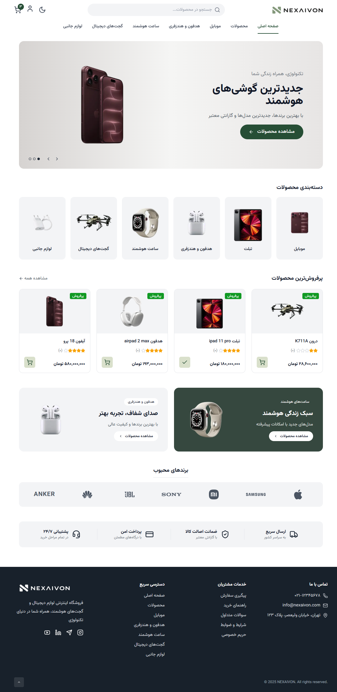
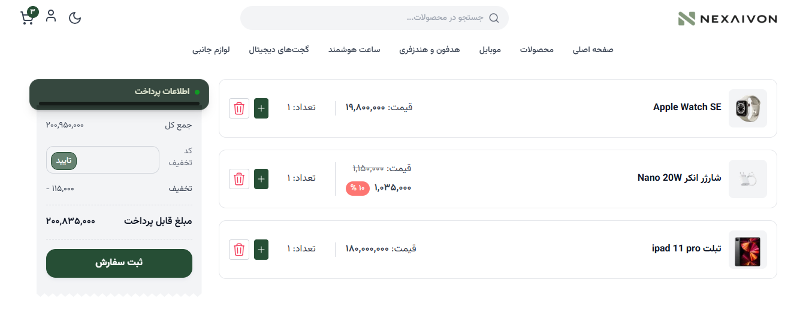
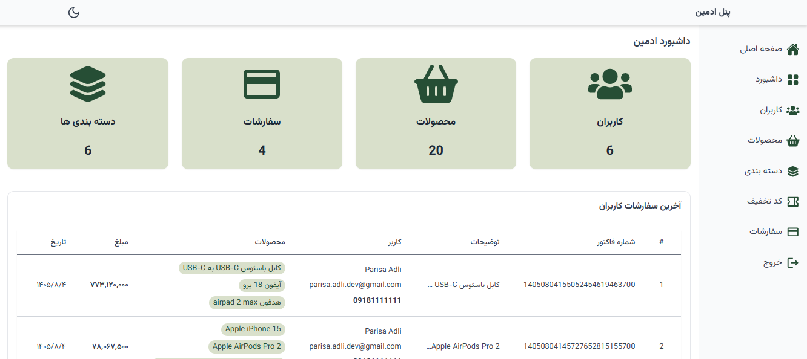

# NEXAIVON

A Persian (RTL) electronics e-commerce store with a full admin panel. Customers browse and filter products, like them, fill a cart, apply coupons and check out; admins manage products, categories, coupons, users, payments and the homepage content.





## Features

**Storefront**

- Homepage with hero, categories, featured products and promo sections, editable from the admin panel
- Product listing with category sidebar, filters, sorting and pagination; product detail pages by slug
- Likes, cart with stock-aware quantities, coupon codes and checkout
- Phone-number login with an SMS one-time password (Kavenegar) and profile completion
- Demo login (user or admin) so the app can be tried without an SMS
- Smooth scrolling and animations (Lenis, GSAP), mobile bottom navigation

**User profile**

- Personal info and order / payment history

**Admin panel**

- Dashboard overview
- CRUD for products (with image upload), categories and coupons
- Users list and details, payments list and details
- Homepage content editor

**Server**

- Server-computed discount prices, stock validation and a safe, conditional stock decrement on payment
- Role-based permission guard, JWT access and refresh tokens in signed cookies
- Restricted static uploads folder with type and size limits on image upload

## Tech stack

| Part               | Stack                                                                                                |
| ------------------ | ---------------------------------------------------------------------------------------------------- |
| Client (`client/`) | Next.js 15 (App Router), React 18, Tailwind CSS, TanStack Query, React Hook Form, Axios, GSAP, Lenis |
| Server (`server/`) | Node.js, Express, MongoDB + Mongoose, Joi, JWT, Multer, Kavenegar SMS                                |
| Testing            | Vitest, Supertest, mongodb-memory-server                                                             |

## Getting started

Requirements: Node.js 18+ and a running MongoDB.

```bash
git clone https://github.com/parisa-adli/NEXAIVON.git
cd NEXAIVON
npm install                          # also installs client and server
cp server/.env.example server/.env   # set APP_DB and the secret keys
cp client/.env.example client/.env   # NEXT_PUBLIC_API_URL=http://localhost:5000/api
npm run seed --prefix server         # demo categories, products, coupons and users
npm run dev                          # API on :5000, store on :3000
```

Outside production the OTP code is written to the server log, so no Kavenegar key is needed locally.

## Scripts

| Command               | What it does                   |
| --------------------- | ------------------------------ |
| `npm run dev`         | Server and client together     |
| `npm run build`       | Production build of the client |
| `npm start`           | Start both in production mode  |
| `npm run test:server` | Server tests                   |

## Project structure

```
client/src/
  app/(user)/      # storefront: home, products, cart, auth, complete-profile
  app/(profile)/   # user profile and payments
  app/(admin)/     # admin panel
  components/, hooks/, services/, constants/
server/
  app/router/      # /product, /category, /cart, /payment, /user, /admin, /home
  app/http/        # controllers, middlewares, validators
  app/models/      # product, category, coupon, payment, user, homeContent
  scripts/         # seed and migrations
  test/            # Vitest suites
docs/              # design spec and task breakdown
```
